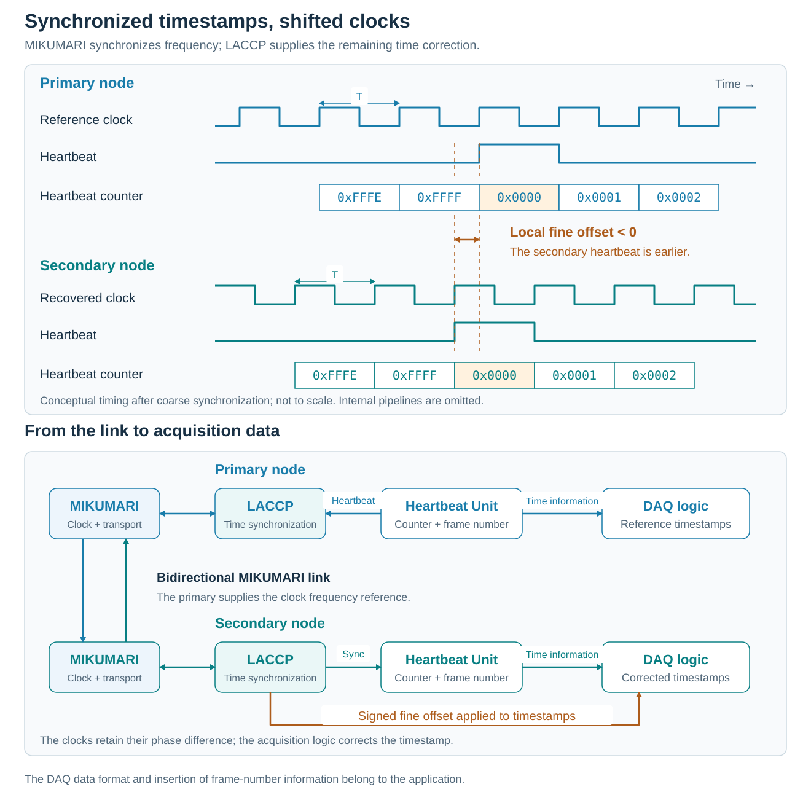

# Get Started

## What is LACCP?

The Local Area Common Clock Protocol (LACCP) synchronizes timestamps across FPGA-based electronics. It is an upper-layer protocol of the MIKUMARI link protocol and is intended for systems such as distributed data acquisition (DAQ), where measurements from different nodes must share a time reference.

LACCP provides heartbeat-counter synchronization, heartbeat-frame information, and a fine timing correction. The acquisition logic combines this information with its measurements to produce timestamps relative to the reference node.

This page introduces the concepts. See [LACCP](../laccp/laccp.md) for the RTL architecture and interfaces, or [Usage](../usage/usage.md) to integrate the blocks into a design.

## Relationship with MIKUMARI

MIKUMARI carries a clock signal and data over the same physical link using clock duty-cycle modulation. The receiving node recovers its clocks from the modulated signal. LACCP uses the communication services of this link to establish a common time reference.

| Layer | Responsibility |
| --- | --- |
| User acquisition logic | Capture measurements and apply the fine correction to their timestamps. |
| LACCP | Synchronize heartbeat counters and frame information; calculate the fine offset. |
| MIKUMARI | Provide clock-frequency synchronization, data-frame communication, and fixed-latency pulse transmission. |

Frequency synchronization alone does not align timestamps: the recovered clock has a phase offset, and the link introduces propagation delay. LACCP accounts for these effects through counter synchronization and timestamp correction. It does not adjust the recovered clock phase to match the reference clock.

Physical connections, clock generation and recovery, and FPGA I/O constraints are described in the [MIKUMARI User Guide](https://ryotarohonda.github.io/ug-mikumari/).

## Primary and secondary

The roles are defined for each link:

| Role | Meaning |
| --- | --- |
| Primary | Supplies the reference clock and time information to the other endpoint. |
| Secondary | Recovers the clock and synchronizes its time information to the primary. |

In a tree-shaped network, the root supplies the original time reference. A relay node acts as a secondary toward its upstream neighbor and as a primary toward downstream neighbors. These roles describe a connection, rather than a permanent classification of an entire FPGA.

## Timestamps and heartbeat frames

Each node maintains a heartbeat counter driven by its local system clock. A heartbeat marks the counter rollover, and the interval between heartbeats is called a heartbeat frame. A frame number distinguishes successive frames.

| Time information | Purpose |
| --- | --- |
| Heartbeat counter | Identify a system-clock interval within a heartbeat frame. |
| Heartbeat frame number | Identify the frame containing that interval. |
| Fine offset | Correct the residual timing difference between the local and reference time bases. |

The counter and frame number provide the coarse timestamp. The fine offset is a signed correction used by the acquisition logic; it is not an additional counter. The resolution of a measurement within a clock interval depends on the acquisition circuit, such as a TDC, rather than on LACCP alone.

LACCP also distributes heartbeat-frame state and flags. These allow acquisition logic to associate activity and status information with the shared frame structure. Timing pulses can carry trigger or reset indications whose effects are implemented by the receiving application.

## How synchronization works

1. MIKUMARI establishes communication between the primary and secondary.
2. LACCP measures a pulse round-trip time and exchanges receiver-delay information.
3. The secondary calculates its counter offset and fine offset, then synchronizes its heartbeat counter and frame information.
4. After the completion exchange, the endpoints report readiness for acquisition.

This is a conceptual sequence: delay-information exchanges and pulse measurements can overlap. Synchronization is performed during initialization; the fine correction is then used by the acquisition logic.

The figure shows the timing relationship after coarse synchronization. Both counters identify corresponding clock intervals, but their rollover edges remain separated because the reference and recovered clocks have different phases. In the illustrated case, the secondary heartbeat is earlier than the primary heartbeat, so the local fine offset is negative. The acquisition logic adds this signed correction to its local measurement timestamp; the clocks themselves remain unchanged.

The lower part shows the flow of time information. The primary Heartbeat Unit supplies heartbeat and frame information, while the secondary Heartbeat Unit synchronizes its local counter and frame number. Acquisition logic uses this coarse time information together with the fine offset from LACCP to timestamp its data. The DAQ data format and insertion of frame-number information are application functions.

This conceptual illustration follows the example on slide 9 of R. Honda, *MIKUMARI, the time synchronization protocol in the SPADI Alliance* (SRO XIV). It omits internal pipeline delays and implementation-specific wiring; see [Heartbeat Units](../laccp/laccp.md#heartbeat-units) for the RTL output timing.

Synchronization accuracy depends on the delay estimation and the physical implementation, including differences between the two transmission directions. The results reported in the [reference papers](../index.md#references) describe their evaluated configurations, rather than a guarantee for arbitrary hardware.

## From one link to a network

Synchronization proceeds from upstream nodes to downstream nodes. A downstream secondary combines its local fine offset with the correction supplied from upstream. This gives its timestamp a reference to the root, rather than only to its immediate neighbor.

The clock-distribution topology and the propagation of time information must be designed together. The RTL interfaces for accumulated offsets and interconnects are described in [LACCP](../laccp/laccp.md); their connections are covered in [Usage](../usage/usage.md#extending-the-configuration).
