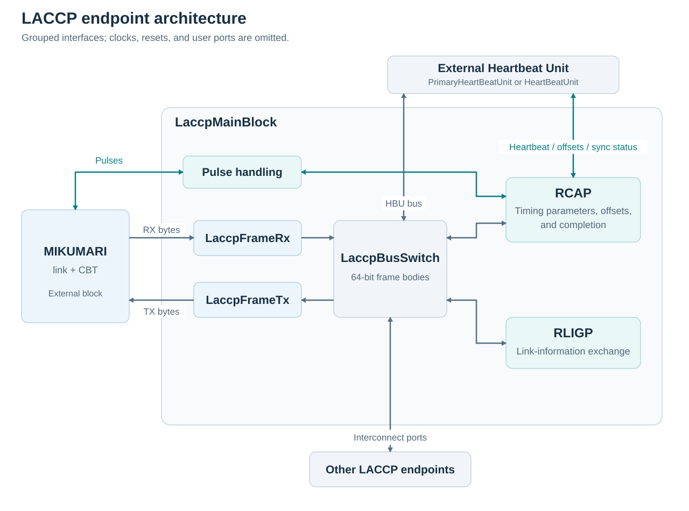

# LACCP

This page describes the architecture, behavior, and public interfaces of the current [LACCP RTL](https://github.com/RyotaroHonda/laccp). Signal names follow the source, including spellings such as `serdesLantencyIn`. For wiring and initialization, see [Usage](../usage/usage.md).

## Architecture

`LaccpMainBlock` implements the LACCP endpoint attached to one MIKUMARI link. It contains the following blocks.

| Block | Function |
| --- | --- |
| `LaccpFrameRx` | Parse the nine-byte LACCP frame received through MIKUMARI. |
| `LaccpFrameTx` | Serialize a LACCP frame body into a MIKUMARI normal frame. |
| `LaccpBusSwitch` | Distribute frame bodies among the MIKUMARI port, local protocol blocks, and interconnect ports. |
| `RCAP` | Measure round-trip time, exchange timing parameters, and calculate synchronization offsets. |
| `RLIGP` | Exchange application-supplied link information with the other endpoint. |

The Heartbeat Unit and MIKUMARI blocks are external to `LaccpMainBlock`. `PrimaryHeartBeatUnit` generates the root heartbeat and frame information. `HeartBeatUnit` receives this information and synchronizes a secondary, or operates independently in stand-alone mode.

The frame path is `MIKUMARI <-> FrameRx/FrameTx <-> BusSwitch <-> protocol blocks`. The pulse path connects directly to the synchronization and user-pulse logic; pulses are not encoded as LACCP frame bodies. The diagram groups the HBU synchronization interfaces with RCAP; their public ports are on `LaccpMainBlock`, which routes the heartbeat pulses.

## LACCP frames and bus

### Frame format

`defLaccp.vhd` defines a nine-byte frame. `LaccpFrameTx` sends the preamble first, followed by the frame body from its most significant byte to its least significant byte.

| Byte | Field | Frame-body bits |
| --- | --- | --- |
| 0 | Preamble, `0xFA` | Not included in the bus frame body. |
| 1 | Destination module address and local address | 63:60 and 59:56 |
| 2 | Source module address and local address | 55:52 and 51:48 |
| 3 | Command bits | 47:40 |
| 4 | Reserved | 39:32 |
| 5–8 | Register value, most significant byte first | 31:0 |

`LaccpFrameBobyType` is the 64-bit frame-body type. The module address selects a protocol endpoint, such as RCAP; the local address selects an operation within that endpoint. These fields are separate from the 32-bit link information exchanged by RLIGP.

| Command bit | RTL constant | Meaning |
| --- | --- | --- |
| 0 | `kCmdPassagePermission` | Permit forwarding to interconnect ports. |
| 1 | `kCmdDepature` | Permit transmission through the local MIKUMARI port. |
| 2 | `kCmdWrite` | Write operation. |
| 3 | `kCmdRead` | Read-operation bit defined in the package. |
| 4 | `kCmdReply` | Reply operation. |
| 5 | `kCmdReplyRequest` | Request a reply. |

The presence of a command constant does not imply that every endpoint implements that operation. The supplied RCAP, RLIGP, and Heartbeat Unit receive logic handles its specific write and reply operations.

The receiver checks the preamble, expected body length, final-byte indication, and checksum status at the expected final byte before releasing a frame body. `frameBrokenRx` and `recvTermndRx` are inputs to the receiver, but the current parser does not use them to change its receive state.

### Bus ports and forwarding

| Internal port | Destination module address | Endpoint |
| --- | --- | --- |
| 0 | Not a local protocol address | MIKUMARI frame transport |
| 1 | `0x1` | RLIGP |
| 2 | `0x2` | RCAP |
| 3 | `0x3` | External Heartbeat Unit |
| 4 onward | Selected by forwarding rules | Interconnects |

Destination module address `0x0` broadcasts to the local protocol ports. A frame is not returned to its originating local port for an ordinary addressed transfer. Passage permission forwards frames to the configured interconnects only when the ingress is not itself an interconnect. Departure permits transmission through MIKUMARI only when the ingress is not MIKUMARI. Interconnect forwarding is a fan-out operation, not an address-to-link routing table.

The current package exposes one external intra port, at array index 0, for the Heartbeat Unit. The external interconnect arrays have 32 elements; `kNumInterconnect` selects the implemented prefix. With no interconnects, use `kNumInterconnect = 0`. Do not consume output elements outside the configured prefix: the main block does not drive them.

Bus data is a complete 64-bit frame body. Assert the associated input-valid signal for one clock to enqueue one body. Receiver readiness gates the output-valid pulse during forwarding; it is not a per-frame acknowledgment or a mechanism that holds a transfer until the destination becomes ready. The switch and protocol FIFOs have finite capacity and do not expose upstream flow control through these ports. Keep custom traffic within the receiver's processing capacity.

## RCAP

RCAP stands for Remote Clock Adjustment Protocol. It has different responsibilities at the two endpoints.

| Primary | Secondary |
| --- | --- |
| Return a received probe pulse. | Send a probe and measure its round-trip time in system-clock counts. |
| Send local receiver parameters, calibration data, and `upstreamOffset`. | Use local and received parameters to calculate the fine offset. |
| Supply heartbeat pulses during synchronization. | Apply the calculated counter offset through the external Heartbeat Unit. |
| Receive the secondary's completion message and reply. | Wait for Heartbeat Unit synchronization, send the completion message, and wait for its reply. |

The secondary starts from half the measured round-trip count. If that count is odd, the fine correction includes half a system-clock period. RCAP combines this with the receiver-delay difference, optional calibration correction, and upstream fine offset. It adjusts the coarse counter offset when normalizing the accumulated fine offset across a system-clock boundary.

The secondary control states are `Init`, `AdjustClock`, `Finalize`, and `Done`. `AdjustClock` waits for `hbuIsSyncedIn`; `Finalize` waits for the completion reply. `isReadyForDaq` is directly connected to RCAP's completion output. The primary reports completion after receiving the secondary's completion message, so the endpoints need not assert readiness on the same clock.

### Time units and offsets

The arithmetic represents **1 ns as 1024 counts**. One fine-offset count is therefore `1/1024 ns`, approximately 0.9765625 ps. This numerical unit is not a claim about synchronization accuracy.

`GetFastClockPeriod(kFastClkFreq)` returns the half-period of the fast clock in these units, rounded to an integer. The current RCAP arithmetic uses eight such half-periods as a system-clock period (`kFullCycle = 8`). The CDCM-8 example in Usage uses a fast-clock frequency four times the system-clock frequency.

| Value | Representation and interpretation |
| --- | --- |
| `roundTripTime` | Unsigned 16-bit count of system clocks, measured by the secondary; zero in primary mode. |
| `hbcOffset` | Unsigned 16-bit heartbeat-counter initialization offset. The Heartbeat Unit loads this value plus one when accepting a synchronization pulse. |
| `fineOffsetLocal` | Signed 16-bit correction for the local link, including the odd-round-trip adjustment and local normalization. Defined by the secondary calculation. |
| `fineOffset` | Signed 16-bit correction after upstream accumulation and normalization. Zero in primary mode. |
| `upstreamOffset` | Signed 16-bit correction supplied by the integrating design for propagation to the downstream secondary. Zero at the root. |
| `calibDelay` | Signed 12-bit local calibration parameter, in the same fine-time units. Exchanged with the partner. |

In secondary mode, use the offsets when `validOffset = '1'`. In primary mode, `validOffset` indicates reception of the secondary's completion information, and `hbcOffset` contains the offset reported by that secondary. `fineOffsetLocal` is not assigned by the primary generate branch; do not use it in primary mode.

Apply the signed fine correction to the local measurement timestamp in the acquisition data path. A positive correction increases the timestamp, and a negative correction decreases it. Preserve the sign and handle carry or borrow across clock and heartbeat-frame boundaries.

### Receiver parameters and calibration

The 7-series calculation uses the IDELAY tap count and signed SerDes latency. Its tap coefficient is 80 fine-time counts, equivalent to 78.125 ps. The UltraScale calculation additionally uses the initial master and slave IDELAY counter values. The current calculation identifies a 7-series receiver by a zero initial master counter value and an UltraScale receiver by a nonzero value.

With `enCalibDelay = true`, `CalcCalibDelay` adds both the local-minus-partner calibration parameter and a family-dependent digital-delay difference before the receiver-delay difference is divided by two. With `false`, this entire additional correction is zero. The generic defaults to `false` in `LaccpMainBlock`, even though the Verilog module has its own default.

Calibration values depend on the implementation. The RTL does not supply a universal set of board-specific values or a procedure to measure them. The [reference papers](../index.md#references) discuss the underlying delay components.

### RCAP local addresses

| Local address | Operation |
| --- | --- |
| `0x0` | Completion message carrying the secondary counter offset. |
| `0x1` | Exchange IDELAY tap count, SerDes latency, and upstream fine offset. |
| `0x2` | Exchange initial IDELAY counter values and calibration parameter. |

## RLIGP

RLIGP stands for Remote Link Information Getter Protocol. It exchanges a 32-bit application-supplied value with the other endpoint. LACCP does not define an IP address format or assign a system-wide identity through this interface.

When `validMyLink` is asserted, RLIGP captures `addrMyLink` and sends it as a write with a reply request to local address `0x0` of the partner's RLIGP endpoint. It retries while waiting for a reply and stops after receiving the reply. To exchange a changed local value after completion, restart the protocol through reset.

Reception of the partner's write sets `addrPartnerLink` and `validPartnerLink`; reset clears the validity. This operation is independent of RCAP completion. `isReadyForDaq` does not include a check of `validPartnerLink`.

## Heartbeat Units

`defHeartBeatUnit.vhd` defines a 16-bit heartbeat counter and a 24-bit heartbeat-frame number. At 125 MHz, one frame lasts 524.288 microseconds, and the combined 40-bit coarse timestamp wraps after approximately 2.44 hours. These durations scale with the system-clock period.

`PrimaryHeartBeatUnit` increments the frame number at heartbeats. Halfway through a heartbeat frame, it samples the acquisition gate and flags and schedules the frame-information message. `forceOn` forces the local frame state active. `primaryRst` resets its counter and frame number and schedules a reset message only while the frame state is idle.

The counter, heartbeat strobe, and frame number are registered in separate processes. During a normal rollover, `heartbeatOut` is high with `heartbeatCount = 0`, and the frame number increments on the following clock, when the counter is 1. Account for this pipeline when assembling a measurement timestamp from the separate outputs. Reset, initial frame acquisition, and frame-number correction are separate cases.

In synchronized mode, `HeartBeatUnit` first loads its counter from `hbcOffsetIn + 1` when both `validOffsetIn` and `syncPulseIn` are high. It then accepts valid global frame information and asserts `isSynchronized`. Subsequent messages update frame state and flags and compare the global frame number with the local one. `hbfNumMismatch` reports a mismatch; `keepLocalHbfNum = '0'` permits correction of the local frame number.

With `enStandAlone = '1'`, `HeartBeatUnit` generates its local frame number and uses its local acquisition controls. This mode does not establish synchronization to another node; `isSynchronized` is not a stand-alone readiness indication.

Frame-information messages use local address `0x0` of the HBU endpoint. The register value contains frame state in bits 31:28, zeros in 27:26, flags in 25:24, and frame number in 23:0. The idle-only primary reset uses a broadcast write with local address `0xF`.

## LaccpMainBlock

### Generics

| Generic | Type / default | Meaning |
| --- | --- | --- |
| `kPrimaryMode` | `boolean`, `false` | Select primary (`true`) or secondary (`false`) RCAP behavior for this link. |
| `kNumInterconnect` | `integer`, `16` | Number of implemented interconnects; use 0–32 to fit the fixed external arrays. |
| `kFastClkFreq` | `real`, `500.0` | SerDes fast-clock frequency in MHz, used by timing calculations. |
| `enDebug` | `boolean`, `false` | Enable the debug attributes controlled by this generic. |
| `enCalibDelay` | `boolean`, `false` | Enable the additional calibration calculation in the secondary. |

### System, user pulses, and RLIGP ports

`SL` below means `std_logic`; `SLV`, `U`, and `S` mean `std_logic_vector`, `unsigned`, and `signed`. Widths are the current package values.

| Port | Direction / type | Meaning |
| --- | --- | --- |
| `rst` | In, SL | Active-high reset request; sampled by the internal reset shift register. |
| `clk` | In, SL | Protocol clock; use the associated MIKUMARI parallel-clock domain. |
| `isReadyForDaq` | Out, SL | RCAP completion for this endpoint. |
| `laccpPulsesIn` | In, SLV(8) | One-clock user-pulse requests; assert at most one bit at a time after synchronization. |
| `laccpPulsesOut` | Out, SLV(8) | Decoded received user pulses, suppressed while RCAP owns the pulse path. |
| `pulseInRejected` | Out, SL | Indicates an input collision or multiple-bit pulse encoding; see operational behavior below. |
| `addrMyLink` | In, SLV(32) | Application-supplied local link information. |
| `validMyLink` | In, SL | Permit RLIGP to capture and send the local information. |
| `addrPartnerLink` | Out, SLV(32) | Received partner information. |
| `validPartnerLink` | Out, SL | Qualify `addrPartnerLink`. |

### Timing and synchronization ports

| Port | Direction / type | Meaning |
| --- | --- | --- |
| `idelayTapIn` | In, U(5) | Local MIKUMARI receiver tap count. |
| `serdesLantencyIn` | In, S(4) | Local SerDes latency in half-fast-clock periods. |
| `cntValueInitIn` | In, SLV(9) | Local initial master IDELAY counter value. |
| `cntValueSlaveInitIn` | In, SLV(9) | Local initial slave IDELAY counter value. |
| `idelayTapOut` | Out, U(5) | Partner tap count received through RCAP. |
| `serdesLantencyOut` | Out, S(4) | Partner SerDes latency received through RCAP. |
| `cntValueInitOut` | Out, U(9) | Partner initial master counter value. |
| `cntValueSlaveInitOut` | Out, U(9) | Partner initial slave counter value. |
| `roundTripTime` | Out, SLV(16) | Secondary round-trip measurement; zero in primary mode. |
| `calibDelay` | In, S(12) | Local calibration parameter. |
| `calibDelayOut` | Out, S(12) | Partner calibration parameter. |
| `hbuIsSyncedIn` | In, SL | Secondary Heartbeat Unit synchronization feedback to RCAP. |
| `syncPulseIn` | In, SL | Heartbeat source for the synchronization transmit path. |
| `syncPulseOut` | Out, SL | Received heartbeat routed to the secondary HBU during synchronization. |
| `upstreamOffset` | In, S(16) | Upstream accumulated correction to advertise to the downstream secondary. |
| `validOffset` | Out, SL | Qualify secondary offsets, or indicate partner completion in primary mode. |
| `hbcOffset` | Out, SLV(16) | Secondary counter offset, or the partner-reported offset in primary mode. |
| `fineOffset` | Out, S(16) | Accumulated secondary fine correction; zero in primary mode. |
| `fineOffsetLocal` | Out, S(16) | Local secondary correction; unused in primary mode. |

Partner timing outputs are diagnostic copies of values received during the exchange, not local IDELAY control outputs. They have no separate output-valid port. Observe them after a completed exchange, rather than assuming they are valid at reset release.

### LACCP Bus ports

Directions are relative to `LaccpMainBlock`.

| Port | Direction / type | Meaning |
| --- | --- | --- |
| `isReadyIntraIn` | In, SLV(1) | External intra endpoint ready to receive forwarded bodies. |
| `dataIntraIn` | In, `ExtIntraType` | One 64-bit body from the external intra endpoint. |
| `validIntraIn` | In, SLV(1) | Enqueue the corresponding input body. |
| `dataIntraOut` | Out, `ExtIntraType` | Body forwarded to the external intra endpoint. |
| `validIntraOut` | Out, SLV(1) | Qualify the forwarded body. |
| `isReadyInterIn` | In, SLV(32) | Readiness of interconnect destinations. |
| `existInterOut` | Out, SLV(32) | High for each configured interconnect; other elements are undriven. |
| `dataInterIn` | In, `ExtInterType` | Array of 32 input frame bodies. |
| `validInterIn` | In, SLV(32) | Input-valid indications for interconnect bodies. |
| `dataInterOut` | Out, `ExtInterType` | Forwarded bodies on configured interconnects. |
| `validInterOut` | Out, SLV(32) | Output-valid indications on configured interconnects. |

### MIKUMARI ports

| Port | Direction / type | Meaning |
| --- | --- | --- |
| `mikuLinkUpIn` | In, SL | MIKUMARI link status; low requests an internal LACCP reset. |
| `dataTx` | Out, `CbtUDataType` (8 bits) | Transmit byte. |
| `validTx` | Out, SL | Transmit byte valid. |
| `frameLastTx` | Out, SL | Final byte of the transmitted LACCP frame. |
| `txAck` | In, SL | MIKUMARI acknowledgment of the transmit byte. |
| `pulseTx` | Out, SL | Pulse transmit request. |
| `pulseTypeTx` | Out, `MikumariPulseType` (3 bits) | Encoded pulse index. |
| `busyPulseTx` | In, SL | MIKUMARI pulse transmitter busy. |
| `dataRx` | In, `CbtUDataType` (8 bits) | Received byte. |
| `validRx` | In, SL | Received byte valid. |
| `frameLastRx` | In, SL | Received frame's final-byte indication. |
| `checkSumErrRx` | In, SL | Received checksum-error indication. |
| `frameBrokenRx` | In, SL | Frame-start error indication, currently buffered but not acted on by the parser. |
| `recvTermndRx` | In, SL | Receive-termination indication, currently buffered but not acted on by the parser. |
| `pulseRx` | In, SL | Received pulse strobe. |
| `pulseTypeRx` | In, `MikumariPulseType` (3 bits) | Received pulse index. |

The normal-frame transmit path uses `txAck` to advance through bytes. Connect this interface directly to MIKUMARI; do not replace the acknowledgment with an assumed byte rate.

## Heartbeat Unit interfaces

Both entities have `enDebug : boolean := false`. The common ports are listed below; names and directions are relative to the Heartbeat Unit.

| Port | Direction / type | Meaning |
| --- | --- | --- |
| `rst` | In, SL | Active-high reset request, sampled by a 16-stage shift register. |
| `clk` | In, SL | Heartbeat and LACCP Bus clock. |
| `heartbeatOut` | Out, SL | Local heartbeat associated with counter rollover. |
| `heartbeatCount` | Out, SLV(16) | Local counter value. |
| `hbfNumber` | Out, SLV(24) | Local heartbeat-frame number. |
| `clkDiv16` | Out, SL | Divide-by-16 output, realigned at heartbeat timing. |
| `hbfCtrlGateIn` | In, SL | Acquisition gate sampled at half-frame timing; local control in primary or stand-alone mode. |
| `forceOn` | In, SL | Force active frame state in primary or stand-alone mode. |
| `frameState` | Out, `HbfStateType` | `kActiveFrame` or `kIdleFrame`. |
| `hbfFlagsIn` | In, SLV(2) | Local flags sampled in primary or stand-alone mode. |
| `frameFlags` | Out, SLV(2) | Flags associated with the local frame state. |
| `dataBusIn` | In, `LaccpFrameBobyType` | Forwarded frame body from the main block. |
| `validBusIn` | In, SL | Qualify the input body. |
| `dataBusOut` | Out, `LaccpFrameBobyType` | Locally generated body; tied to zero in `HeartBeatUnit`. |
| `validBusOut` | Out, SL | Qualify an outgoing body; tied low in `HeartBeatUnit`. |
| `isReadyOut` | Out, SL | Bus receive readiness; tied high in both entities. |

`PrimaryHeartBeatUnit` has one additional port:

| Port | Direction / type | Meaning |
| --- | --- | --- |
| `primaryRst` | In, SL | Synchronous request to reset the time counters and send a reset message while idle. |

`HeartBeatUnit` has the following additional ports:

| Port | Direction / type | Meaning |
| --- | --- | --- |
| `enStandAlone` | In, SL | Select independent local operation instead of synchronized frame operation. |
| `keepLocalHbfNum` | In, SL | Preserve the local frame number on subsequent mismatches when high. |
| `syncPulseIn` | In, SL | Received synchronization heartbeat. |
| `hbcOffsetIn` | In, SLV(16) | Counter offset to load on synchronization. |
| `validOffsetIn` | In, SL | Qualify the counter offset. |
| `isSynchronized` | Out, SL | Counter and global frame information have been acquired in synchronized mode. |
| `hbfNumMismatch` | Out, SL | Most recently compared global and local frame numbers differ. |

`PrimaryHeartBeatUnit` does not process `dataBusIn` or `validBusIn`. In synchronized `HeartBeatUnit` operation, frame state and flags come from upstream messages rather than the local acquisition-control inputs.

## Operational behavior

### Reset and link loss

The main block samples `rst OR NOT mikuLinkUpIn` through a 16-stage shift register. The Heartbeat Units similarly sample their own `rst`, but have no link-status input. Keep their clocks running and provide reset requests long enough to pass through the shift registers.

Link loss resets the main block's frame, bus, RCAP, and RLIGP logic after the shift-register delay. It does not directly reset the external Heartbeat Unit or qualify all user-pulse outputs. The integrating design must reset the secondary Heartbeat Unit for reacquisition and gate application use of timestamps and pulses with current link and readiness status.

RCAP releases its pulse takeover after completion. It does not continuously realign the heartbeat counter or recalculate the fine offset after completion; restart synchronization after a change requiring a new timing solution.

### User pulses

During synchronization, RCAP owns the pulse path. Received heartbeat and probe pulses are used internally, and `laccpPulsesOut` is zero. After completion, an index from 0 to 7 is converted between a one-hot LACCP vector and a MIKUMARI pulse type.

| Downstream pulse index | Package definition |
| --- | --- |
| 0 | `kDownPulseTrigger` |
| 1 | `kDownPulseCntRst` |
| 2 | `kDownPulseSysRst` |
| 3–7 | Reserved definitions |

All upstream user-pulse indices are reserved in the current package. These names label pulse indications; they do not reset application logic automatically.

Use one-clock, one-hot requests only when the link and LACCP are ready. A request arriving while the MIKUMARI transmitter is busy or the main block already has a pulse registered sets `pulseInRejected`. Multiple active input bits also cause a rejection indication, but the current encoder still registers a pulse type; do not depend on the flag to suppress malformed requests. There is no user-pulse queue or automatic retry in this interface.

### Source map

| Source | Reference content |
| --- | --- |
| `laccp/LaccpMainBlock.vhd` | Top-level ports, pulse handling, external bus mapping, reset. |
| `laccp/defLaccp.vhd` | Frame layout, bus types, addresses, pulse indices, fine-time scale. |
| `laccp/RCAP.vhd`, `CalcFineLantency_US.v`, `CalcCalibDelay.v` | Offset calculation, calibration, synchronization completion. |
| `laccp/RLIGP.vhd` | Link-information exchange. |
| `laccp/PrimaryHeartBeatUnit.vhd`, `HeartBeatUnit.vhd`, `defHeartBeatUnit.vhd` | Heartbeat and frame behavior and interfaces. |
| `laccp/LaccpBusSwitch.vhd`, `LaccpFrameTx.vhd`, `LaccpFrameRx.vhd` | Frame forwarding and transport. |
