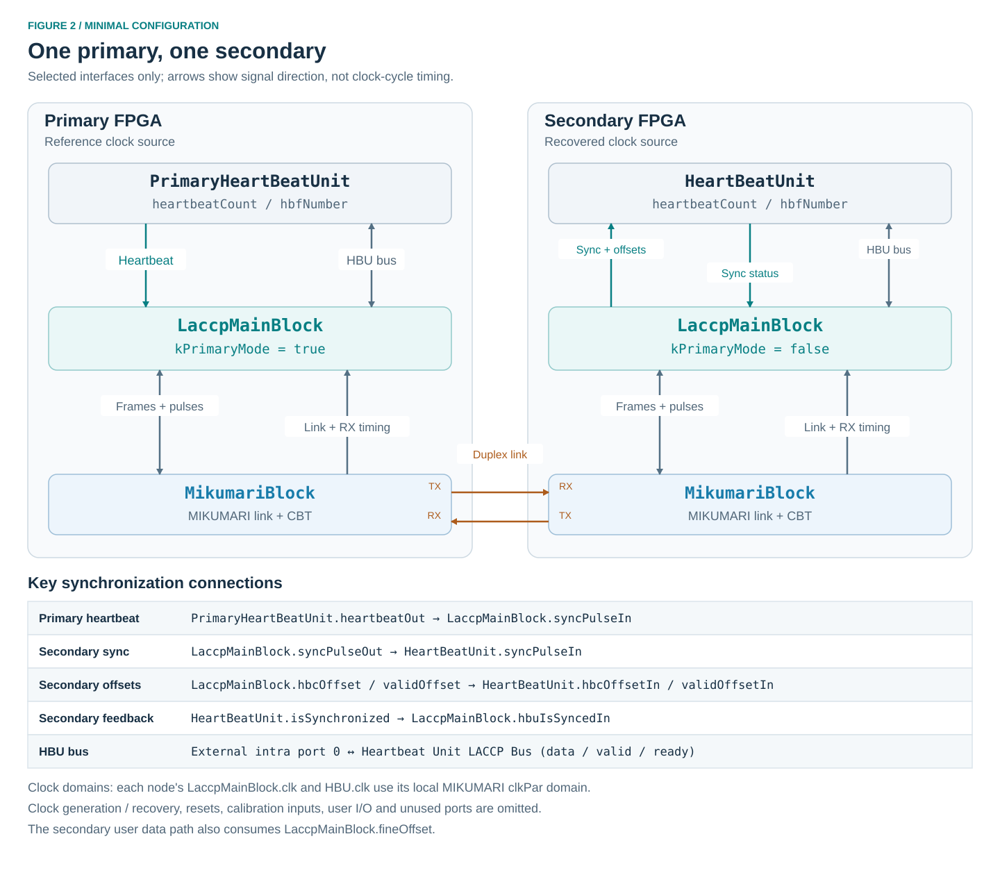
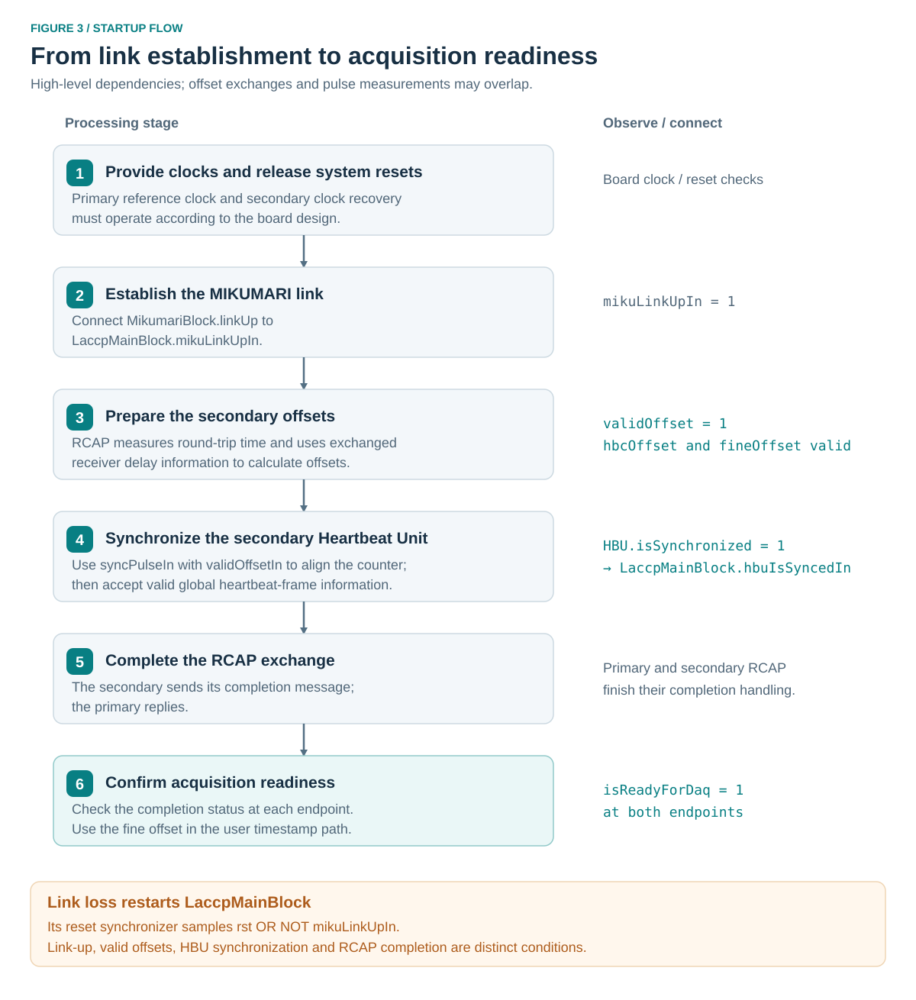

# Usage

This page describes a primary–secondary connection using one MIKUMARI link. It gives the LACCP connections and bring-up checks; clock generation, FPGA pin assignments, and board constraints belong to the integrating project. See [Get Started](../get-started/get-started.md) for the concepts and [LACCP](../laccp/laccp.md) for signal definitions.

## Prerequisites

Prepare a bidirectional MIKUMARI connection and the clocks and resets required by both endpoints. Consult the [MIKUMARI User Guide](https://ryotarohonda.github.io/ug-mikumari/) for physical-layer integration. The LACCP README lists AMD 7-series and UltraScale support; the v2.0 change log also identifies UltraScale+. Its stated tool test environment is Vivado 2025.2 or earlier.

For the following connection example, use:

| Setting | Primary | Secondary |
| --- | --- | --- |
| Clock source | Local reference | Clock recovered from the primary's modulated signal |
| MIKUMARI configuration | Compatible CDCM-8 settings | Matching CDCM-8 settings |
| Example parallel / fast clock | 125 / 500 MHz | 125 / 500 MHz |
| MIKUMARI pulse mode | `kHighPrecision = false` | `kHighPrecision = false` |
| LACCP endpoint | `LaccpMainBlock` in primary mode | `LaccpMainBlock` in secondary mode |
| Heartbeat source | `PrimaryHeartBeatUnit` | `HeartBeatUnit` in synchronized mode |

The frequencies are example values, not a timing-closure guarantee for every device. Set `kFastClkFreq` to the actual fast-clock frequency. The current LACCP offset arithmetic uses eight half-fast-clock periods per system-clock period, consistent with this CDCM-8 configuration.

## Add the sources

Obtain the [LACCP](https://github.com/RyotaroHonda/laccp) and [MIKUMARI](https://github.com/RyotaroHonda/mikumari) repositories and add their required RTL to the Vivado project. Use a submodule or a recorded revision so that the two source versions used by the design are identifiable.

| Source group | Integration action |
| --- | --- |
| MIKUMARI | Add the CBT, MIKUMARI link, and `Wrapper/MikumariBlock.vhd` sources needed by the selected FPGA implementation. |
| LACCP packages | Add `defLaccp.vhd`, `defHeartBeatUnit.vhd`, and `defBitwiseOp.vhd` from `laccp/`. |
| LACCP blocks | Add the main block, frame TX/RX, Bus Switch, RCAP, RLIGP, and both Heartbeat Unit entities. |
| LACCP utility | Add the VHDL utility files, including `MyFifoComClock` and its RAM dependencies. |
| Timing arithmetic | Add `CalcFineLantency_US.v` and `CalcCalibDelay.v`. The former instantiates `udiv_q_cbt_axis`, supplied by MIKUMARI together with its divider core. |

Assign the VHDL sources referenced as `mylib.*` to the `mylib` library. Analyze packages before their users, and RAM units before the FIFO. Let Vivado update compile order after all files are added. No LACCP source requires VHDL-2008 according to the repository README.

RCAP references the Verilog timing modules through `work.CalcFineLantency_US` and `work.CalcCalibDelay`; preserve those mixed-language bindings when setting up project libraries. Check elaboration for both modules and their divider dependencies, including when using a 7-series secondary: the secondary generate branch instantiates the UltraScale calculation modules as well.

## Configure the nodes



### Endpoint settings

| Setting or input | Primary | Secondary |
| --- | --- | --- |
| `kPrimaryMode` | `true` | `false` |
| `kNumInterconnect` | `0` for this example | `0` for this example |
| `kFastClkFreq` | Actual fast-clock frequency in MHz | Actual fast-clock frequency in MHz |
| `enDebug` | Enable if internal debug probes are needed | Enable if internal debug probes are needed |
| `enCalibDelay` | Set explicitly; the correction is calculated in the secondary | Enable when using the additional calibration correction |
| `upstreamOffset` | Zero at the root | Zero in this example; a secondary does not advertise upstream timing to another secondary |
| `hbuIsSyncedIn` | Tie low; primary RCAP does not use this feedback | Connect from `HeartBeatUnit.isSynchronized` |
| `syncPulseIn` | Connect from `PrimaryHeartBeatUnit.heartbeatOut` | Tie low for this leaf-only example |

Configure the secondary HBU with `enStandAlone = '0'` and `keepLocalHbfNum = '0'`. The latter permits correction if a later received frame number differs from the local number. Tie its local `hbfCtrlGateIn`, `forceOn`, and `hbfFlagsIn` low when using upstream acquisition controls.

On the primary HBU, drive `hbfCtrlGateIn` from the acquisition gate and `hbfFlagsIn` from the application. For an initial synchronization check, both may be zero and `forceOn` may be low: synchronization does not require an active acquisition frame. Keep `primaryRst` low except when intentionally requesting an idle-state reset.

Set a stable 32-bit `addrMyLink` value at each endpoint and assert `validMyLink` when it is available. For a bench example, distinct constants such as `0x00000001` and `0x00000002` can identify the endpoints. These are application-chosen RLIGP values, not LACCP bus destination addresses.

### Unused ports

With `kNumInterconnect = 0`, tie `isReadyInterIn` and `validInterIn` low and all elements of `dataInterIn` to zero. Leave `existInterOut`, `dataInterOut`, and `validInterOut` open. Keep `laccpPulsesIn` zero until testing user pulses. Unused diagnostic outputs can be left open, including primary-mode `fineOffsetLocal`.

Do not tie the external intra port off: it is the HBU connection required to distribute heartbeat-frame information. On the primary, the unused `syncPulseOut` can be left open.

## Connect the blocks

### Clocks and resets

For each node, use the local MIKUMARI `clkPar` domain for `LaccpMainBlock.clk` and HBU `clk`. Supply the serial and IDELAY reference clocks required by MIKUMARI separately. These interfaces do not include clock-domain crossing between the main block and the HBU.

Provide a system reset to the primary HBU and main block. For a secondary that must reacquire synchronization after link loss, include link loss in its HBU reset request, for example:

```vhdl
-- Concurrent assignments in the secondary integration architecture.
-- link_up is MikumariBlock.linkUp; all consumers use clkPar.
secondary_hbu_rst <= system_rst or not link_up;
```

The main block already includes `not mikuLinkUpIn` in its own internal reset request. The HBU does not. Keep `clkPar` running while resetting or reacquiring the blocks, and hold system reset for at least 16 active clock edges so it reaches their internal reset shift registers. Manage MIKUMARI power-on reset and clock recovery according to the board's clock/reset design.

### MIKUMARI connection

Connect these ports at both endpoints. The arrow denotes the signal direction.

| Source | Destination |
| --- | --- |
| `MikumariBlock.linkUp` | `LaccpMainBlock.mikuLinkUpIn` |
| `LaccpMainBlock.dataTx` | `MikumariBlock.dataInTx` |
| `LaccpMainBlock.validTx` | `MikumariBlock.validInTx` |
| `LaccpMainBlock.frameLastTx` | `MikumariBlock.frameLastInTx` |
| `MikumariBlock.txAck` | `LaccpMainBlock.txAck` |
| `LaccpMainBlock.pulseTx` | `MikumariBlock.pulseIn` |
| `LaccpMainBlock.pulseTypeTx` | `MikumariBlock.pulseTypeTx` |
| `MikumariBlock.busyPulseTx` | `LaccpMainBlock.busyPulseTx` |
| `MikumariBlock.dataOutRx` | `LaccpMainBlock.dataRx` |
| `MikumariBlock.validOutRx` | `LaccpMainBlock.validRx` |
| `MikumariBlock.frameLastRx` | `LaccpMainBlock.frameLastRx` |
| `MikumariBlock.checksumErr` | `LaccpMainBlock.checkSumErrRx` |
| `MikumariBlock.frameBroken` | `LaccpMainBlock.frameBrokenRx` |
| `MikumariBlock.recvTermnd` | `LaccpMainBlock.recvTermndRx` |
| `MikumariBlock.pulseOut` | `LaccpMainBlock.pulseRx` |
| `MikumariBlock.pulseTypeRx` | `LaccpMainBlock.pulseTypeRx` |

For the example's low-latency pulse mode, tie MIKUMARI `pulseRegTx` to zero and leave `pulseRegRx` open. Do not drive the MIKUMARI normal-frame input or pulse input from a second user source while they are connected to LACCP.

### Receiver timing information

These are local receiver measurements, including on the primary. Connect the outputs directly rather than substituting fixed tap or latency values.

| MIKUMARI output | LACCP input | Conversion |
| --- | --- | --- |
| `tapValueOut` | `idelayTapIn` | Cast `std_logic_vector` to `unsigned`. |
| `serdesOffset` | `serdesLantencyIn` | Direct signed connection. |
| `cntValueOutInit` | `cntValueInitIn` | Direct vector connection. |
| `cntValueOutSlaveInit` | `cntValueSlaveInitIn` | Direct vector connection. |

For example, if `miku_tap` is the signal connected to `tapValueOut`, use `idelayTapIn => unsigned(miku_tap)` in the main block's port map. The 7-series MIKUMARI implementation supplies zero initial counter values; the UltraScale implementation supplies its measured values. Preserve this distinction because RCAP uses it to select the delay calculation.

The similarly named LACCP outputs are copies of **partner** information. They are not inputs for changing local IDELAY settings.

### Heartbeat and synchronization connections

| Node | Source | Destination |
| --- | --- | --- |
| Primary | `PrimaryHeartBeatUnit.heartbeatOut` | `LaccpMainBlock.syncPulseIn` |
| Secondary | `LaccpMainBlock.syncPulseOut` | `HeartBeatUnit.syncPulseIn` |
| Secondary | `LaccpMainBlock.hbcOffset` | `HeartBeatUnit.hbcOffsetIn` |
| Secondary | `LaccpMainBlock.validOffset` | `HeartBeatUnit.validOffsetIn` |
| Secondary | `HeartBeatUnit.isSynchronized` | `LaccpMainBlock.hbuIsSyncedIn` |

### HBU bus connection

At both endpoints, connect the HBU to external intra array index 0. This is internal bus port `kPortHBU = 3`; do not use external array index 3.

The following concurrent assignments show the complete bus connection. The `hbu_*` signals connect to the corresponding ports of the local Heartbeat Unit, and `intra_*` signals connect to the main block.

```vhdl
intra_data_in(0)  <= hbu_data_out;   -- HBU.dataBusOut
intra_valid_in(0) <= hbu_valid_out;  -- HBU.validBusOut
intra_ready_in(0) <= hbu_ready;      -- HBU.isReadyOut

hbu_data_in  <= intra_data_out(0);   -- HBU.dataBusIn
hbu_valid_in <= intra_valid_out(0);  -- HBU.validBusIn
```

Use `ExtIntraType` for the data arrays and vectors of `kNumExtIntraPort` bits for their valid/ready signals. In the main block's port map, these signals correspond to `dataIntraIn`, `validIntraIn`, `isReadyIntraIn`, `dataIntraOut`, and `validIntraOut`, respectively. Even though the secondary HBU generates no outgoing frames, connect its bus outputs and readiness in the same way.

## Configure timing correction

At the root primary, set `upstreamOffset` to zero. Connect a stable local `calibDelay` at each endpoint before starting RCAP. Values use the fine-time unit defined in [Time units and offsets](../laccp/laccp.md#time-units-and-offsets), rather than raw picoseconds.

Enable `enCalibDelay` on the secondary when applying the additional calibration correction. This enables both the family-dependent digital-delay term and the local-minus-partner calibration term. It does not merely enable a user-provided constant. With it disabled, those extra terms are omitted; do not interpret that configuration as validation of timing accuracy between arbitrary devices.

Choose calibration values from the timing characterization of the actual implementation. The repository does not provide universal values for every FPGA, pin assignment, or board. A functional bring-up with zero calibration inputs and correction disabled establishes the connection and control flow, but does not establish the accuracy of the resulting timestamp correction.

Keep timing inputs stable during the exchange. Restart synchronization after changing calibration or the clock configuration.

## Startup and verification



1. Establish the primary clock and secondary clock-recovery path. Apply the board's power-on and protocol resets with the required clocks present.
2. Release reset according to the clock/reset design. Confirm MIKUMARI `laneUp` and then `linkUp` at both endpoints, and check its receiver error outputs.
3. Confirm the main blocks receive `mikuLinkUpIn = '1'`. Allow their reset shift registers to clear. On the secondary, the link-dependent HBU reset request must also clear.
4. Observe the secondary's `roundTripTime` and wait for `validOffset = '1'`. Its `hbcOffset` and `fineOffset` can then be consumed. Exchanges and measurements proceed in the RTL without a software start command.
5. Confirm the secondary HBU receives `syncPulseIn`, `hbcOffsetIn`, and `validOffsetIn`. Confirm heartbeat-frame messages reach its bus input and `isSynchronized` becomes high.
6. Confirm that `isSynchronized` reaches `hbuIsSyncedIn`. Wait for RCAP's completion exchange and for `isReadyForDaq = '1'` at both endpoints.
7. Separately check `validPartnerLink` and the expected `addrPartnerLink` at both endpoints. RLIGP completion is not part of the RCAP readiness output.

Keep application data marked unsynchronized until the link, HBU synchronization, and RCAP readiness are valid for the current connection. Readiness is an initialization result, not a measurement of the achieved timing accuracy. Validate timestamp alignment on the target hardware using a common timing reference, accounting for the measurement paths.

For a reconnect, block acquisition use of the old time solution, reset the secondary HBU as described above, and repeat the checks. Ensure that both main blocks restart RCAP, either through their link-dependent resets or an explicit reset at both endpoints. An HBU-only reset after RCAP completion does not restart the main block's RCAP exchange.

## Use timestamps and pulses

### Timestamp construction

Capture `hbfNumber` and `heartbeatCount` consistently with the measurement. After aligning them to the same heartbeat frame, the coarse timestamp is their 40-bit concatenation, with the frame number as the most significant part. At the example's 125 MHz clock, each coarse count represents 8 ns.

Account for the HBU output pipeline at rollover: in normal operation the counter reaches 0 and asserts the heartbeat strobe before the frame number increments on the following clock. Sampling the two outputs without boundary handling can therefore associate counter value 0 with the previous frame number. Align the measurement pipeline and frame selection explicitly; see [Heartbeat Units](../laccp/laccp.md#heartbeat-units).

For an acquisition circuit that also measures a fine time within the clock interval, form the local measurement time using that circuit's convention, then add the signed `fineOffset` correction after converting to common units. At this example frequency, one coarse count is 8192 LACCP fine-time counts.

As an arithmetic example, a correction value of `-1024` represents `-1 ns`, not `-1024 ps`. Use sufficient signed precision and propagate carry or borrow across coarse-count and frame boundaries. The acquisition-specific timestamp format and its fine-time interpolation are outside the LACCP blocks.

### Acquisition state

Drive the root HBU's acquisition gate, and consume `frameState` and `frameFlags` at each node to associate data with the propagated frame state. Root `forceOn` can force its state active; normal gate and flag updates are associated with half-frame timing. Do not substitute a combinational copy of the root gate for the HBU's frame-state output.

### User pulses

After both endpoints complete synchronization, assert one bit of `laccpPulsesIn` for one local clock. For a downstream trigger indication, use index `kDownPulseTrigger`. Observe the corresponding bit of `laccpPulsesOut` at the secondary and implement the intended application action there.

Monitor `busyPulseTx` and `pulseInRejected`; requests have no queue or automatic retry. Space requests so that the MIKUMARI transmitter is available and the previous local pulse registration has cleared. Never assert multiple pulse-vector bits together. A rejection flag does not guarantee that a malformed multiple-bit request produced no transmitted pulse.

Use link and readiness status to qualify received user pulses. During synchronization the pulse path is reserved for RCAP. System-reset and counter-reset pulse names are indications only; connect their effects explicitly in the application.

## Troubleshooting

| Symptom | Checks |
| --- | --- |
| `laneUp` stays low | MIKUMARI clocks, power-on reset, pin assignments, polarity, I/O standards, IDELAY setup, and receiver errors. |
| `laneUp` is high but `linkUp` is low | MIKUMARI link configuration and both communication directions. LACCP remains in reset while its link input is low. |
| Secondary `validOffset` stays low | Probe pulse wiring, local tap/SerDes outputs, both initial counter values, actual `kFastClkFreq`, and RCAP frame exchanges. |
| Offsets are valid but HBU synchronization stays low | `enStandAlone = '0'`, HBU reset release, sync/offset connections, and heartbeat-frame delivery through external intra port 0. |
| HBU is synchronized but RCAP readiness stays low | `isSynchronized` feedback wiring and the completion-message/reply path. |
| `validPartnerLink` stays low | Local `validMyLink` and stable `addrMyLink` at both endpoints, RLIGP frame transport, and reset state. |
| Synchronization does not recover after reconnect | Secondary HBU reset on link loss, running clocks during reset, and a fresh RCAP exchange. |
| Frame-number mismatches persist | HBU bus delivery, `keepLocalHbfNum`, reset sequencing, and custom bus traffic exceeding FIFO capacity. |
| Control flow completes but timestamps disagree | Signed fine-offset application, its unit conversion, coarse/fine capture boundaries, calibration, and directional path asymmetry. |
| `pulseInRejected` is asserted | Multiple active request bits, a busy pulse transmitter, or a previous pulse still registered locally. |

For internal observation, enable the relevant `enDebug` generics and inspect the marked signals with the project's debug setup. The public signals listed above remain the primary checks for integration.

## Extending the configuration

For a relay FPGA, instantiate a secondary endpoint toward upstream and primary endpoints toward downstream. Share the synchronized local `HeartBeatUnit` time base with the downstream primary endpoints: use its `heartbeatOut` for their `syncPulseIn`, and pass the upstream secondary endpoint's accumulated `fineOffset` to each downstream primary endpoint's `upstreamOffset`. Hold the downstream-facing main blocks in reset until the upstream time solution is ready, while allowing their MIKUMARI clocks and links to operate. The RTL has no separate validity input for `upstreamOffset`.

Forward the HBU frame information through the LACCP interconnects. For an upstream endpoint A and downstream endpoint B using interconnect index 0, the basic same-clock connections are:

```vhdl
-- A and B denote signal prefixes for two LaccpMainBlock instances.
b_inter_data_in(0)  <= a_inter_data_out(0);
b_inter_valid_in(0) <= a_inter_valid_out(0);
a_inter_ready_in(0) <= b_exist_inter_out(0);

a_inter_data_in(0)  <= b_inter_data_out(0);
a_inter_valid_in(0) <= b_inter_valid_out(0);
b_inter_ready_in(0) <= a_exist_inter_out(0);
```

Configure both endpoints with at least one interconnect and use only implemented array elements. `existInterOut` indicates that a port exists, not that downstream synchronization has completed. The direct wiring above requires a shared clock domain and the supplied FIFO-based receiver behavior; add an explicit clock-domain crossing if the endpoint clocks differ.

The relay's HBU can receive the upstream frame information through the upstream endpoint's external intra port while its interconnects carry that information toward downstream endpoints. An unused local HBU port on a downstream-facing endpoint can be tied inactive. Design the interconnect fan-out according to the [bus forwarding rules](../laccp/laccp.md#bus-ports-and-forwarding), and distribute reset and acquisition-readiness decisions consistently across the relay.
